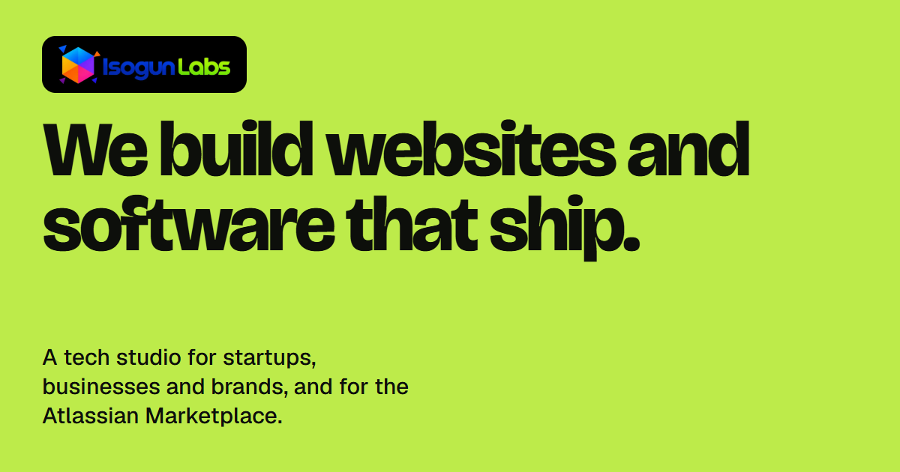

# Isogun Labs website

[](https://isogunlabs.com)

This is the source code of **[isogunlabs.com](https://isogunlabs.com)**, the website of Isogun Labs, a studio that designs and builds websites, web apps and Atlassian Marketplace apps.

[Visit the site](https://isogunlabs.com) · [Services](https://isogunlabs.com/services/) · [Recent work](https://isogunlabs.com/work/) · [Blog](https://isogunlabs.com/blog/) · [Start a project](https://isogunlabs.com/contact/)

## What Isogun Labs does

- **Websites and web apps** for startups, businesses and brands, each designed and coded from scratch.
- **Atlassian Marketplace apps**, including Recap for Jira, Field Hygiene for Jira and Passdown for JSM.

The site you can see here is itself an example of the work: a fast, static site with its own design system, a blog, structured data for search engines, and an automated deploy.

© Isogun Labs. All rights reserved. This code is public so you can see how the studio builds, and it is not licensed for reuse (see [Rights](#rights)).

---

# For maintainers

Everything below is for working on the site.

## Built with

- [Astro](https://astro.build) 7, as a static site with no client framework
- Plain CSS in one stylesheet, Geist and Bricolage Grotesque fonts (self-hosted)
- Markdown content collections for the blog
- GitHub Pages for hosting, deployed by GitHub Actions

## Getting started

```
npm install       # first time, and after pulling dependency changes
npm run dev       # local dev server with hot reload
npm run build     # production build into dist/
npm run preview   # serve the built dist/ locally
npm run sitemap   # regenerate public/sitemap.xml (see "Adding content")
```

Node 22 or later is recommended, the same version the deploy workflow uses.

## Project structure

```
src/
  layouts/BaseLayout.astro   shared <head>, navigation, mobile menu and footer
  components/                Seo, Nav, Footer, Icon, SocialLinks, BlogCard, BlogCover,
                             BlogSidebar, ShareBar, ScreenshotSlider
  data/nav.ts                navigation links, social profile URLs and the call to action
  lib/blogCategory.ts        blog categories, derived from each post's cover value
  content.config.ts          blog content collection and its frontmatter schema
  content/blog/*.md          blog posts
  pages/                     one file per route (see below)
public/                      files copied as they are to the site root
scripts/sitemap.mjs          builds public/sitemap.xml
```

Routes in `src/pages/`:

| Route | Page |
| --- | --- |
| `/` | Home |
| `/services/` | Services |
| `/work/` | Recent work |
| `/contact/` | Contact, the single "Start a project" destination |
| `/get-started/` | Atlassian apps chooser (the address is kept for SEO) |
| `/documentation/`, `/support/` | App documentation and the support policy |
| `/blog/`, `/blog/<slug>/` | Blog index and posts |
| `/rss.xml` | Blog feed |

`public/` holds the stylesheet, scripts, fonts, icons, images, `robots.txt`, `sitemap.xml`, `site.webmanifest`, `CNAME`, and the Bing and IndexNow verification files.

## Adding content

**A new blog post.** Add a Markdown file to `src/content/blog/` with this frontmatter:

```yaml
---
title: "Post title"
description: "One or two sentences, used in cards, search results and sharing."
pubDate: 2026-11-20
updatedDate: 2026-11-25   # optional
draft: true               # optional: drafts are hidden everywhere and left out of the sitemap
cover: web                # fields | report | market | trust | web
---
```

`cover` sets the cover art and the category label on the post's card. To add a new category, extend `BLOG_CATEGORIES` in `src/lib/blogCategory.ts`, the `cover` list in `src/content.config.ts`, and the matching artwork in `BlogCover.astro`.

**A new page.** Create `src/pages/<name>/index.astro`, wrap it in `<BaseLayout>`, add it to `src/data/nav.ts` if it belongs in the menu, and add it to the `pages` list in `scripts/sitemap.mjs`.

**After adding a page or publishing a post**, run `npm run sitemap` and commit the updated `public/sitemap.xml`. It is not generated during the build, and the deploy workflow reads the committed file.

## Branches and deployment

Work happens on `dev`. Merging into `main` publishes the site.

Pushing to `main` runs `.github/workflows/deploy.yml`, which builds the site and deploys it with GitHub Pages (the Pages source is **GitHub Actions**, not "Deploy from a branch"). `dist/` is never committed.

A second job, `notify-indexnow`, runs after each deploy. It reads every URL in `public/sitemap.xml` and sends them to the IndexNow service so Bing and similar search engines pick up changes without waiting for a crawl. Google does not use IndexNow; resubmit the sitemap in Search Console to prompt it. Because of this, an out-of-date `sitemap.xml` under-reports what changed on every deploy, so keep it in sync.

## Things to know

- `trailingSlash: 'always'` in `astro.config.mjs` keeps addresses matching the ones already indexed (`/get-started/`, not `/get-started`). Do not change it without checking Search Console and Bing Webmaster Tools first.
- Analytics (GA4) and the Bing verification tag are set up once in `BaseLayout.astro`. Page titles, descriptions, social sharing tags and the structured data (organisation, website, services, apps, breadcrumbs) come from `Seo.astro`, and blog posts add their own article data, so every page stays consistent.
- The site is light and dark by the visitor's system setting (`prefers-color-scheme`).

## Design system

One stylesheet, `public/assets/css/site.css`. The accent is a lime taken from the logo, set on neutral green-greys. The header, footer and Atlassian band stay on the logo's own black because the logo file is a wordmark on black. Display type is Bricolage Grotesque and text is Geist.

Icons are Phosphor glyphs in `public/assets/icons/ui/`, drawn with a CSS mask through `src/components/Icon.astro`. Technology logos in `public/assets/tech/` come from Simple Icons. Stock photos in `public/assets/photos/` are from Pexels (free licence), and the work screenshots in `public/assets/work/` come from the case studies at [portfolio.isogunlabs.com](https://portfolio.isogunlabs.com).

---

## Rights

Copyright © Isogun Labs. All rights reserved. The code, design, text and images in this repository are published so you can see the studio's work. They are not licensed for copying, republishing or reuse without written permission. The Atlassian apps, logos and any third-party brand names belong to their owners.

## Contact

[tomisin@isogunlabs.com](mailto:tomisin@isogunlabs.com), or [start a project](https://isogunlabs.com/contact/).
